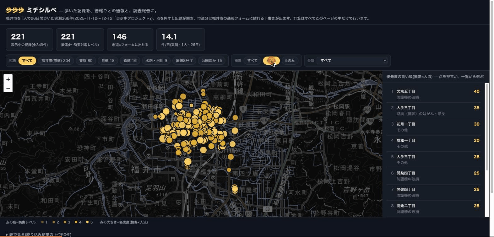
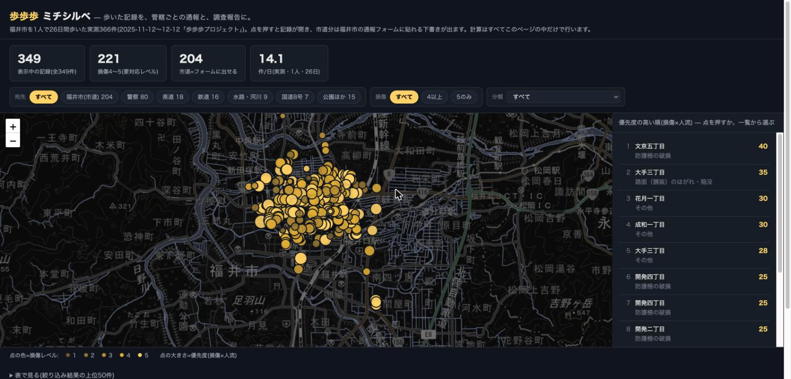
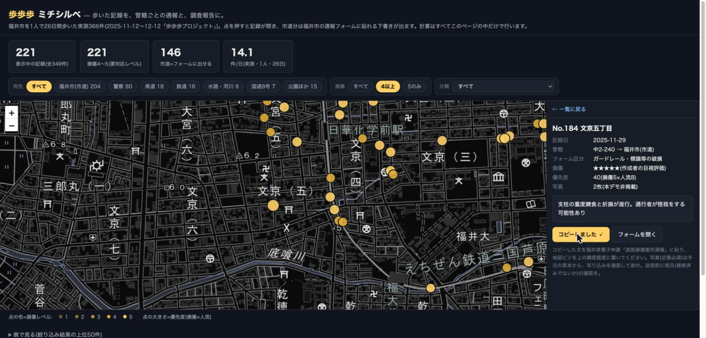
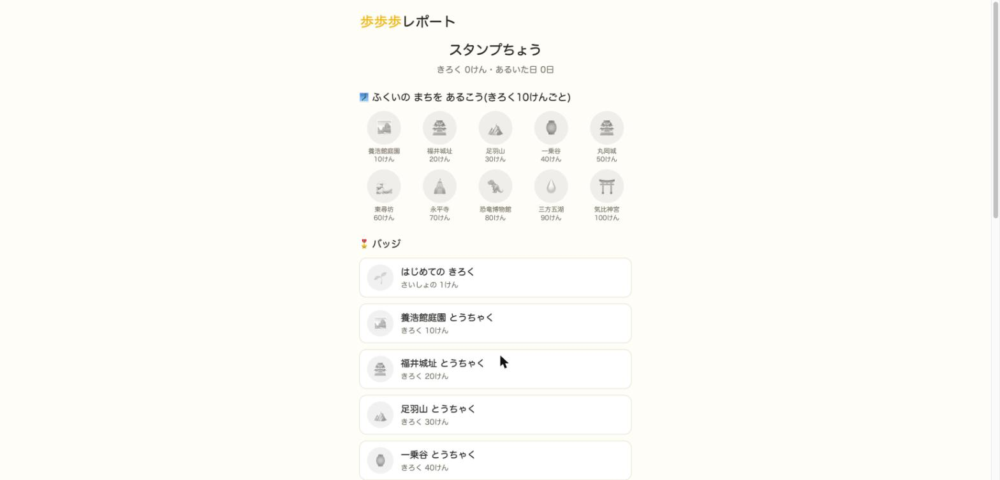

# ミチシルベ

**歩いた記録を、管轄ごとの通報と、道路に出す調査報告に。**

福井市を1人で26日間歩いて記録した道路の損傷366件(2025-11-12〜12-12「歩歩歩プロジェクト」)を、地図で見て、福井市の通報フォームに貼れる下書きに変えるツールです。福祉事業所の訓練として街を計画的に歩き、見つけた損傷を「誰に言うか」まで仕分けて届ける事業(ミチシルベ)の実測デモでもあります。「歩歩歩(ほほほ)」は合同会社HOHOHOの社名の由来です。



- **デモ(可視化)**: https://hohoho-f.github.io/michishirube/
- **報告アプリ(当事者用)**: https://hohoho-f.github.io/michishirube/report.html — スマホで開いて「ホーム画面に追加」

開くと実測データが入っています。点を押すと記録が開き、市道の箇所は「通報文をコピー」で福井県電子申請フォームに貼れる文が出ます。計算はすべてブラウザの中だけで行い、どこにも送信しません。

## すぐ試す(インストール不要)

| やりたいこと | 操作 |
|---|---|
| 損傷の分布を見る | デモを開く。点の色=損傷レベル、大きさ=優先度(損傷×人流) |
| 危ない所から見る | 右の一覧(優先度順)か、絞り込み「損傷5のみ」 |
| 誰に通報すべきか知る | 宛先チップで絞る。市のフォーム対象外(警察・鉄道・県道など)が44%ある |
| 通報の下書きを作る | 市道の点を押して「通報文をコピー」→ [福井県電子申請「道路損傷箇所通報」](https://shinsei.e-fukui.lg.jp/SksJuminWeb/EntryForm?id=6zl6aoBB)に貼る |
| 歩く人の体験を試す | [報告アプリ](https://hohoho-f.github.io/michishirube/report.html)で「きろくする」(文字入力は一切なし) |

手元で動かす場合: このリポジトリを取得して `index.html` をブラウザで開くだけです(地図タイルの表示にのみ通信します)。

## 誰が、何に困っているか

| 数字 | 内容 | 出典 |
|---|---|---|
| 84% | 日本の道路122万kmのうち市町村道が約103万km。橋梁73万橋の約7割も市町村管理 | [国交省道路局(H29)](https://www.soumu.go.jp/main_content/000497036.pdf) |
| 約8倍 | 市町村管理橋梁の診断区分Ⅳ(緊急措置段階)の発生割合は国管理の約8倍 | 同上 |
| 44%→67% | 建設後50年経過橋梁の割合。現在約44%、10年後には約67% | [国交省 道路データブック2026](https://www.mlit.go.jp/road/toukei_chousa/road_db/pdf/2026/14-1-1.pdf) |
| 343橋→884橋 | 福井市管理橋梁1,735橋のうち建設後50年経過は約20%、10年後には約50% | [福井市橋梁長寿命化修繕計画(2025.3)](https://www.city.fukui.lg.jp/kurasi/koutu/douro/kyouryochoujyumyouka_d/fil/bridge_2503.pdf) |
| 年約2,500件 | 市民からのLINE通報件数(福岡市・人口約160万人、令和6年度)。自然発生の市民通報はこの規模感 | [福岡市](https://www.city.fukuoka.lg.jp/doro-gesuido/doroiji/hp/line-tsuho.html) |
| 月額24,141円 | 就労継続支援B型事業所の全国平均工賃(令和6年度・18,245事業所)。事業所は仕事(発注)を恒常的に必要としている | [厚労省](https://www.mhlw.go.jp/content/12200000/001637154.pdf) |

道路の劣化は「一番人と金がない管理者(市町村)」に一番多く積まれていて、これから加速します。市民通報の仕組みはあるが**受け身**で、どこを誰がいつ見たかは誰も管理していない。一方で、仕事を必要としている福祉事業所が市内全域に分布している。この2つの空白を、1本の仕組みでつなぎます。

## 届いていない人と、その人を阻む壁

| 届いていない人 | 持っているもの | 壁 | このツールで外す壁 | 外せない壁 |
|---|---|---|---|---|
| 市の道路課 | 法定点検(橋・トンネル)、パトロール車、通報フォーム | 生活道路・歩道は点検の網の外。通報は偶然任せ | 「計画的に歩く人」が空白を埋め、**市の指定チャネル(フォーム)のまま**通報の量と質を上げる | 補修予算の年度サイクル。受け取りはフォーム一本(市の指定) |
| 歩行弱者(視覚障害者・車椅子・高齢者) | 点字ブロック・防護柵等の設備 | 壊れていても誰も通報しない(実測: 損傷4〜5が64%) | 損傷×人流の優先度で「人が多く通る危険」から先に届ける | 補修するかどうかは行政の判断 |
| 通報したい市民・当事者 | 市のフォーム | 9区分・999字・写真要件は難しい。管轄も分からない | 報告アプリは撮って選ぶだけ。変換・仕分けは幹事とAIが担う | 民地・管理者不明は通報先が無い(実測17件≒5%) |
| B型事業所 | 働き手と時間 | 仕事が恒常的に足りない。屋外の生産活動の選択肢が少ない | 歩行+記録を生産活動として発注。市全域の事業所網=調査網 | 各事業所の受注判断・利用者の体調 |

## 実測1ヶ月の結果

| 項目 | 実測値 |
|---|---|
| 記録 | 366件(全件写真つき)/26日/1人/平均14.1件・日 |
| 範囲 | 福井市内70地区(市内約2,700町丁目の約2.6%) |
| 損傷4〜5 | 235件(64%) |
| 管轄仕分け | 市道204件(フォームに出せる)/警察80・県道18・鉄道16・水路9・国道8号7(窓口が別)/民地・不明17(通報先なし) |

市のフォームに出せるのは56%だけ。残り44%は窓口が別で、この「誰に言うかの仕分け」が市民通報アプリに一番欠けている部分です。

優先度上位の例(損傷×人流): ①文京五丁目・防護柵の破損(5×8=40) ②大手三丁目・県道の舗装陥没(5×7=35) ③花月一丁目・点字ブロックの欠け(5×6=30) ④開発四丁目・防護柵の長区間倒壊(5×5=25)

## 画面と可視化

### 可視化デモ



**見せているもの**: 国土地理院の地図の上に、実測349点。点の色=損傷レベル(1〜5の単色濃淡)、大きさ=優先度(損傷×人流)。**理解をどう助けるか**: 「どこが・どれだけ・どの順で危ないか」が一画面で分かる。色は損傷にだけ使い、宛先や分類は色ではなくチップで絞る。



**見せているもの**: 記録の詳細(記録日・管轄と宛先・フォーム区分・損傷・優先度・状況の原文)と「通報文をコピー」。**理解をどう助けるか**: 記録がそのまま「フォームに貼れる文」になることを、押した瞬間に体験できる。状況文は歩いた人の原文のまま(AIによる書き換えなし)。

### 報告アプリ「ほほほレポート」

| ホーム | 記録(写真) | スタンプ帳 |
|---|---|---|
|  |  |  |

歩く当事者が使う画面。設計原則は**「書かない・選ぶだけ」**: 写真(近くで1枚→離れて1枚)→6つの絵ボタンで分類→危険度3択→GPS自動→おくる。フォームの9区分や999字の文章は当事者に一切触れさせず、幹事側で変換します。記録10件ごとに福井の名所スタンプ(養浩館庭園→福井城址→…→気比神宮で福井一周)、バッジは**連続ではなく累計**(体調に波がある人が途切れた日に責められない設計)。ユーザー登録は不要で、スタンプもバッジも端末の中だけに保存されます。

## 使う場面の例

**① 事業所の訓練日(歩く人)**
入れるもの: 歩いていて見つけた防護柵の破損。写真2枚+絵ボタン2タップ。
出るもの: スプレッドシートに1行(写真はDriveへ自動保存)。本人は文章を書かない。

**② 幹事の週次(検品と通報)**
入れるもの: スプシの未検品行。
出るもの: 管轄を仕分けて、市道分はフォーム項目(9区分・999字・環境依存文字なし・近景写真必須)に合わせた通報下書き。実測204件の変換は受入条件の機械照合で全件通過済み。送信は1件ずつ人が押す——市民向けフォームに機械で流し込むことはしない。

**③ 市民として今すぐ**
入れるもの: デモで「損傷5のみ」に絞って気になる1件。
出るもの: 「通報文をコピー」→福井県電子申請フォームに貼って、自分の名前で通報できる。

## 流れ(全体)

```
報告アプリ(歩く人: 撮る・選ぶだけ)
  → スプレッドシート(gas/Code.gs で自動格納、写真はDriveへ)
  → 幹事の検品(管轄仕分け・AIが状況文を下書き・人が確認)
  → 福井市フォーム(市の指定チャネルに1件ずつ)/管轄外は各宛先へ
```

行政の受け取りは「LINE→フォーム」一本と指定されています(実地ヒアリング)。だからこの仕組みは市に新しい受け口を要求しません——**いつものフォームに、通報の量と質だけが上がって届く**。AIの役割は「人が見て、AIが整える」: 見るのは歩く当事者、整える(下書き・重複判定)のは幹事側で、数字と座標は機械照合、送信は人が押します。

## 歩くことの、当事者にとっての価値

- BMJ(2024)のネットワークメタ解析(218のRCT・14,170名)は、うつ病に対してウォーキング/ジョギングが中等度の症状軽減(Hedges' g −0.62)を示し、心理療法・抗うつ薬と並ぶ中核的治療の一つとして考慮しうると結論しています([Noetel et al. BMJ 2024;384:e075847](https://www.bmj.com/content/384/bmj-2023-075847))。同解析はエビデンス確信度を「低」と自己評価しており、効果が示されているのは主にうつ・不安症状の軽減です。「特性が治る」とは書きません。個々の適否は支援の専門職の判断です
- 歩く当事者は、歩行弱者の視点を自分の身体で持っています。点字ブロックの欠損に最初に気づくのは、その道を歩く人です

歩行は訓練として当事者に効き、通報は市に効き、体験はまちづくりのデータになる——三つが同じ散歩から出ます。

## お金の流れ(事業として)

| 財布 | 誰が払う | 何への対価 |
|---|---|---|
| ① 福祉給付 | 制度(国保連) | 訓練・生産活動というサービスの提供 |
| ② 調達費 | 市 | 「歩行調査と通報運用」という役務(データ納品ではない) |
| ③ 民間 | 鉄道等の設備事業者・協賛企業 | 自社設備の歩行者目線スクリーニング(実測にえちぜん鉄道13件・JR3件) |

②には制度の背骨があります: 障害者優先調達推進法により自治体は障害者就労施設等からの物品・役務の調達に努め、毎年実績を公表します。[令和6年度の全国実績は約246億円、うち市町村が176億円](https://www.mhlw.go.jp/content/12203000/001619638.pdf)で最大の買い手。[福井県の調達方針](https://www.pref.fukui.lg.jp/doc/shougai/yusenhattyu_d/fil/housin.pdf)は「分野を限定しない」「共同受注窓口経由も準じて扱う」と明記しており、複数事業所の共同受注まで制度側に用意があります。

「福祉だから安い」は売り文句にしません。言うべきはこうです: **建設コンサルの単価では、市道2,100kmの生活道路に値段がつけられなかった。訓練コストを福祉制度が持つこの仕組みなら、今まで誰も値段をつけられなかった空白に、初めて現実的な値段がつく。**

## 効果の見積もり(仮定つきの上限)

| 見方 | 上限 |
|---|---|
| 発見能力 | 14.1件/日(実測・1人)。訓練ペースでは下回る可能性が高い |
| カバー範囲 | 1人・1ヶ月で市内約2.6%。全域は単純外挿で約38人月 → 1事業所では不可能で、事業所ネットワークと委託事業の規模である根拠 |
| 市側の価値 | 損傷4〜5の235件は、自然発生の通報を待っていたら届かなかった可能性が高い(福岡市160万人で年2,500件との比較) |

仮定: 記録密度は実測平均。損傷レベルは作成者の目視評価であり、国の定期点検の診断区分(Ⅰ〜Ⅳ)とは別物——参考であり、診断ではありません。役務の単価は未調査のため書きません。

## 試行錯誤の跡

| 時期 | やったこと | 結果と学び |
|---|---|---|
| 2025/11〜12 | 1人で26日・366件を歩いて記録(歩歩歩プロジェクト)。Excel+マイマップ手作業 | 福井ビジネスコンテスト2025審査員特別賞。**しかし買い手を設計していなかった**ため、受賞のまま休眠 |
| 2026/7 | 福祉事業(就労支援)との接続を構想 | 「あれもこれもやっても動ける人がいない」が壁。構想止まり |
| 2026/10 | 「歩行体験による都市環境データ事業」企画書(二層構成) | 方針は固まったが、動く実物がなかった |
| 2026/11/16 | ハッカソン提出物の README の粒度(一行目は変換・数字に出典・外せない壁を書く・未実装を書く)で全面再設計 | 1年前のExcelの**管轄列こそが商品の核心**(誰に言うかの仕分け)だと判明。366件が実測デモに化けた |
| 同日 | 「月次報告+データ一式を協定で渡す」案を設計 | **行政の実地指摘(報告はフォームから)で撤回**。出口をフォーム送信そのものに合わせたら、「市は新しい受け口を作らなくていい」という強い形になった |
| 同日 | 福井県電子申請フォームの実項目を確認 | 1年前のExcelが最初からフォーム互換の設計だったと判明(分類名・記述欄・写真2枚構成が一致)。変換1本で204件の下書きを一括生成、機械照合全件OK |
| 2026/11/17 | CARTOの地図タイルがAPIキー必須化で表示不能に | 国土地理院タイル(淡色)+CSS反転に差し替え。出典記載だけで使え、行政向けデモとしても筋が良くなった |

## 2026年の答え合わせ(進行中)

歩歩歩で記録した箇所のうち、2026年に予算がついて補修されたものがあることを、行政の公開資料で確認済みです。件数・箇所の整理とExcel「対応状況」列への記入を進めています。書き方の決まり: 通報していない箇所は「危険と評価した箇所が1年以内に補修された」=優先度評価の妥当性の傍証として書き、因果(自分のおかげ)は主張しません。

## データの扱い

- 計算はブラウザ内のみ。入力・送信機能はなく、どこにも何も送りません(地図タイルの取得を除く)
- 現場写真366枚は、写り込み(顔・車両ナンバー等)のぼかし処理前のため**非掲載**
- 民地とみられる箇所・管理者不明の17件は**非表示**(他人の敷地の状態を座標つきで公開しないため)
- 報告アプリは記録者の本名を持たず、スタンプ・バッジは端末内のみ。個人の作業量を外部に出しません

## 未実装

| 項目 | 理由 |
|---|---|
| フォームへの自動入力(送信支援) | 受け皿は行政の電子申請のため、貼り付け用の下書きまでに留める。次段はスプシ→自動入力(送信ボタンは人) |
| 検品のAI下書き(写真+選択→状況文) | 幹事確認を前提に設計中 |
| 写真の表示 | ぼかし処理の運用手順が未設計のため |
| 複数事業所での記録の取り込み | 参加事業所ネットワークが構築前のため |
| 通報→補修の突合表示 | 2026年補修箇所の確認・記入が進行中のため |
| 説明動画 | 準備中 |

## 仕組み

| 部分 | 内容 |
|---|---|
| `index.html` | ファイル1枚の可視化デモ。データ埋め込み・Leaflet+国土地理院タイル。開くだけで動く |
| `report.html` | ファイル1枚の報告アプリ。文字入力なしの記録フロー+スタンプ帳。登録不要・端末内保存 |
| `gas/Code.gs` | 報告→スプレッドシート格納+写真Drive保存(Google Apps Script。貼ってデプロイするだけ) |
| `data/` | 公開用データ(CSV)。実測の原本(Excel・写真)は非公開 |

## 出典

- 歩歩歩プロジェクト実測データ(2025-11-12〜12-12、作成者記録)
- 福井県電子申請サービス「道路損傷箇所通報」(フォーム項目は2026-11-16確認)
- 国土交通省 全国の人流オープンデータ(優先度の人流重み)
- 国交省道路局「道路構造物のメンテナンスの現状」/道路データブック2026
- 福井市橋梁長寿命化修繕計画(2025.3)/福岡市LINE通報実績
- 厚労省「障害者優先調達推進法に基づく調達実績(令和6年度)」/「令和6年度工賃(賃金)の実績」
- Noetel M, et al. BMJ 2024;384:e075847(運動とうつのネットワークメタ解析)
- 地図: [国土地理院タイル](https://maps.gsi.go.jp/development/ichiran.html)(淡色地図)を加工して作成

## License

MIT License — 合同会社HOHOHO
